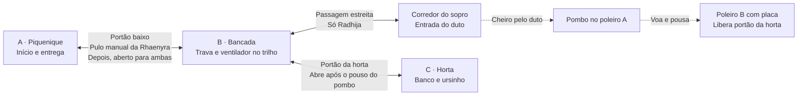

# Proposta da fase 6 com pulo e superbafo

Data: 17 de outubro de 2026. Responsável: Codex, frente de planejamento.

O usuário pediu uma proposta que combine o pulo da Rhaenyra e o superbafo da
Radhija. A sugestão é **Operação Piquenique**: buscar o ursinho no cantinho da
horta e levá-lo à toalha do piquenique. Cenário, nome e objeto ainda aguardam
aprovação. Esta entrega contém somente o desenho da fase; não há fase 6
implementada, protótipo jogável ou alteração no catálogo.

O objetivo é combinar habilidades já ensinadas nas fases 4 e 5, sem introduzir
um comando novo. O jogador abre um caminho para a irmã, prepara a corrente de
ar e usa o cheiro para liberar a volta com o brinquedo. As passagens conquistadas
permanecem abertas até reiniciar, sem provas de velocidade ou saltos precisos.

## Cenário e percurso propostos

Um quintal em manhã de sol, com três áreas compactas: a toalha do piquenique,
uma bancada de jardinagem com ventilador e a horta. Um ursinho ficou sob o banco
da horta. O ambiente pode usar o preset diurno existente e o tipo de item `bear`,
que já possui modelo, ícone, pose de boca e efeitos. Toda a arte continua
procedural. O primeiro protótipo usará blocos, antes de detalhar plantas e móveis.

O desenho abaixo representa conexões, não coordenadas nem escala. Norte é −Z;
a câmera observa do sul. As medidas serão decididas no protótipo com colisão real.

Rhaenyra percorre A → salto para B → trava → ventilador → portão aberto para C.
Radhija espera em A, acompanha por A → B após a abertura, entra e sai do corredor
estreito, passa de B para C e busca o ursinho sob o banco. O retorno é C → B → A
pelos dois portões abertos; nenhuma dog precisa pular carregando o brinquedo.
Rhaenyra consegue acompanhar toda a volta. Sob o banco e no corredor, ela espera
do lado de fora, sem tentar atravessar colisores reservados à pequena.

## Três etapas de cooperação

### 1 Abrir caminho para a irmã

Rhaenyra pula um portão baixo e abre a trava do lado da bancada. O portão fica
aberto. A altura visual inicial pode partir dos 0,42 m usados na fase 5, mas
largura, aproximação e área de pouso precisam passar pelo protótipo.

Radhija não consegue pular. Seu objetivo indica trocar de personagem; depois
da abertura, ela pode seguir normalmente. O comando Fica é opcional para
organizar a companheira, não uma exigência de sincronização nesta etapa.

Objetivos: “Pule o portão com a Rhaenyra” e, do outro lado, “Abra a trava para
a Radhija”. Dica ao tentar alcançar a trava pelo lado errado: “A trava fica do
outro lado. A Rhaenyra consegue pular!”. Usar as marcações de comandos existentes
para que teclado e controle recebam os ícones corretos.

### 2 Preparar o vento e levar o cheiro até o pombo

Rhaenyra empurra o ventilador por um trilho até uma marca visível. Radhija passa
por baixo da bancada e sopra na corrente de ar. O duto leva a nuvem até o pombo,
que voa para um segundo poleiro com placa. O pouso aciona a abertura permanente
do portão da horta. Uma tomada curta de câmera mostra a relação entre pombo,
placa e portão, seguindo o exemplo da fase 4.

O trilho deve permitir empurrar nos dois sentidos, com espaço para Rhaenyra
contornar o ventilador. Os limites evitam que ele saia da área útil. Estar na
marca não é uma ação irreversível: até o pombo reagir, sair dela desativa a
entrada do duto e devolve o objetivo de alinhamento.

Objetivos: “Encaixe o ventilador na marca com a Rhaenyra”, “Entre sob a bancada
com a Radhija” e “Solte o superbafo na corrente de ar”. Dicas distinguem aparelho
pesado, posição errada, falta de vento e personagem grande demais. Latir perto
do pombo pode dar uma dica; não substitui o superbafo.

O cheiro atual é simulado em XZ. A altura visual do poleiro não o protege de
um sopro direto, e `addNose` testa distância, não oclusão visual. Posicionar o
alvo suficientemente afastado das paredes, do portão e de qualquer ponto
alcançável em B, considerando também o raio máximo da nuvem. O protótipo deve
provar que só o percurso pelo duto resolve a etapa; não presumir isso pelo desenho.

### 3 Buscar o ursinho e voltar juntas

Com o portão da horta aberto, Radhija entra sob o banco para pegar o ursinho.
Rhaenyra pode explorar a área e acompanhar a volta. Três petiscos opcionais
incentivam explorar A, o corredor estreito e C, sem bloquear a conclusão.

Objetivos: “Pegue o ursinho sob o banco com a Radhija” e “Leve o ursinho à toalha
do piquenique”. O percurso de volta é largo e legível. Os portões não fecham
quando o ventilador sai da marca ou a dog troca de personagem. A comemoração
usa pontos válidos para ambas, sem inserir a companheira dentro de móveis.

## Estados e recuperação de ações

Etapas propostas: `start`, `accessOpen`, `gardenOpen`, `carrying`, `done`.
Guardar separadamente o estado dos portões, `fanAligned`, o pombo
(`perched`, `flying`, `landed`) e o portador do item. O objetivo deve refletir a
próxima condição que falta; não depender de o jogador executar ações na ordem
descrita no roteiro.

| Situação | Comportamento esperado |
|---|---|
| Rhaenyra alinha o ventilador antes de abrir a primeira trava | Preservar alinhamento; continuar pedindo abrir a passagem para Radhija. |
| Sopro antes de alinhar, de fora do corredor ou com personagem errada | Não abrir a horta; oferecer dica contextual e permitir repetir. |
| Ventilador sai da marca antes de a nuvem entrar no duto | Entrada deixa de aceitar nuvens; voltar a indicar alinhamento. |
| Ventilador sai da marca com nuvem já dentro do duto | A nuvem conclui o percurso, como no campo de cheiro atual. O efeito não é cancelado retroativamente. |
| Vários sopros durante o voo ou depois do pouso | Só um voo, uma abertura e um conjunto de eventos de conclusão. |
| Troca de personagem durante trava, empurrão ou mira | Respeitar o núcleo existente; manter trava na personagem correta, encerrar o empurrão/mira conforme o contrato e permitir continuar. |
| Pausa durante trava, nuvem ou voo | Retomar do mesmo ponto, sem concluir a etapa durante a pausa. |
| Radhija tenta buscar o item antes da abertura | Geometria e interação impedem antecipar a coleta; o objetivo continua na condição pendente. |
| Troca de personagem com item na boca | Item permanece com a portadora; a companheira percorre os portões abertos e a entrega funciona. |
| Reinício durante qualquer etapa | Voltar ao estado inicial completo, sem item preso à boca nem callbacks duplicados. |

`reset()` deverá restaurar portões e trava, posição e alinhamento do ventilador,
posição do pombo, placa, nuvens, petiscos, item, dicas e temporizadores. Registrar
ventos, duto e nariz uma vez por instância de puzzle. `scent.reset()` limpa
nuvens, mas conserva esses registros: restaurar suas propriedades sem registrá-los
novamente a cada reinício. `jumpToStage()` deverá produzir estados coerentes
para depuração, sem emitir sons ou aberturas duplicadas.

## Peças existentes e trabalho específico da fase

Referências verificadas no código da base `b1b026e`. A combinação ainda requer
implementação e validação próprias; a tabela distingue peças prontas de exemplos.

| Necessidade | Base real e trabalho previsto |
|---|---|
| Pulo e portão baixo | Movimento já existe; a fase 5 marca `gate.col.jumpable = true`. Reutilizar `createHingedGate`, com geometria e layout novos. |
| Trava acessível por um lado | `createLockedInteractable` fornece `near`, `start`, `update`, `lockFor` e `reset`. O puzzle deve chamar `near(c)` antes de `start(c)` e definir `canUse` por lado da passagem. |
| Ventilador empurrável | `createPushCrate` limita posição e aceita `prop.setPos`. Alinhamento, encaixe e atualização da origem do vento são lógica da fase, como em `fase4/puzzle.js`. |
| Transporte do cheiro | `ctx.scent.addWind`, `addDuct({ active })` e `addNose({ onSmell })` existem. Dimensões e posição precisam de teste no layout novo. |
| Pombo acionando placa | A fase 4 faz voo, pouso, animação da placa e `gate.lock()` no próprio puzzle. Não há um componente genérico “pombo abre portão” pronto; escrever a orquestração da fase. |
| Modelos de pombo e ursinho | `createPigeon()` em `src/world/pigeon.js` e `createTeddyBear()` em `src/world/toys.js` são exports compartilhados. Criar os adaptadores de props da fase. |
| Modelos de ventilador, portão e placa | Os construtores visuais das fases 4/5 são funções internas de seus `world/props.js`. Servem de referência; não importar o cenário inteiro nem prometer reuso direto desses construtores. |
| Item, dicas e petiscos | `createCarryItem`, `createHints`, `createCollectibles`, `deliveredAt` e `buildTreats` já existem. Usar `bear` evita criar novo tipo de item. |

Fontes: [puzzle da fase 4](../src/levels/fase4/puzzle.js),
[puzzle da fase 5](../src/levels/fase5/puzzle.js),
[campo de cheiro](../src/game/mechanics/scent.js),
[mecânicas](../src/game/mechanics/index.js) e [tipos](../src/types.d.ts).

Contrato proposto de cenário: dois portões com `setOpen`, trava com `setTurn`,
ventilador com `setPos` e `setAligned`, pombo com `setPose`, placa com `setPress`,
ursinho com `object` e estado inicial, colecionáveis e `reset`. O modelo de
ursinho retorna um `Object3D`; o wrapper do prop será responsabilidade da fase.
Descrever e verificar esses contratos com objetos reais, seguindo EST-06.

Todas as coordenadas ficam no layout. O grafo terá nós livres para ambas as
dogs e flags de portão baseadas na abertura efetiva, não apenas na intenção
de abrir. A companheira não executa saltos: não liberar a aresta do portão
baixo antes da abertura. Na passagem pequena, usar `requires: 'small'`, com
nós fora dos colisores que bloqueiam a grande. Não colocar nó obrigatório sob
o banco apenas porque Radhija cabe lá.

O cenário deve montar tudo dentro de `root` e carregar por `load()` com import
dinâmico. Materiais, geometrias, texturas, registros e callbacks devem seguir a
propriedade e o descarte definidos em EST-05. O puzzle usa eventos existentes
(`latch:start`, `fan:aligned`, `pigeon:flee`, `pigeon:land`, `plate:press`,
`gate:open`, `gate:locked`, `item:pickup`) com os dados esperados pelo feedback.

## Critérios para o protótipo e a entrega

- [ ] Fechar cenário, brinquedo e objetivo com o usuário; manter `fase6` como
  ID candidato e não alterar IDs das fases publicadas.
- [ ] Criar protótipo em worktree própria, inicialmente em `DEV_LEVELS` e
  testes próprios, sem tocar no núcleo, save ou UI das outras frentes.
- [ ] Concluir a partida por comandos reais, com teclado e gamepad simulado;
  conferir também controle físico e descoberta do puzzle na revisão humana.
- [ ] Demonstrar que pulo, passagem pequena e superbafo são necessários, sem
  atalhos pelo alcance do nariz, paredes finas, arrancada ou coleta à distância.
- [ ] Testar todos os casos da tabela, reinício em cada etapa, Fica/Vem,
  bloqueio da companheira, portões, colisores e retorno carregando o item.
- [ ] Confirmar uma vitória, contagem correta de petiscos e ausência de erros
  de console; voltar ao menu e reabrir a fase sem estado residual.
- [ ] Validar props reais, carregamento sob demanda e descarte após alternar
  fases. Medir memória e quadros em qualidade real, separado do E2E reduzido.
- [ ] Ao registrar em `LEVELS`, atualizar o `hasNext` da fase 5 nos testes Node
  e na partida E2E, além do README e da arquitetura. Save válido com a fase 5
  concluída deve liberar a 6 sem perder tempos ou petiscos anteriores.
- [ ] Adicionar a suíte em `tools/scripts/run-e2e.mjs` e nas opções e matriz de
  `.github/workflows/e2e.yml`. O smoke do build já descobre `LEVELS` dinamicamente.
- [ ] Executar tipos, testes, build e E2E no GitHub; apresentar o mesmo head e
  a base atualizada na prévia. Nenhum comando de teste/build local é necessário.

## Sequência e coordenação

Esta proposta documental pode ser revisada enquanto a estabilização avança.
Após escolher o desenho, o protótipo pode começar em uma branch separada; usar
a prévia do PR para separar o progresso do principal. `DEV_LEVELS` sozinho
não cria uma chave de save isolada.

Antes de incorporar a fase ao catálogo principal, concluir EST-03 e EST-04 e
validar carregamento recuperável e compatibilidade do progresso. Antes de
finalizar o cenário, adequar recursos e props aos resultados de EST-05/EST-06.
O protocolo de expansão e as medições alimentam EST-08; limites de desempenho
serão definidos após uma medição, sem estimativas apresentadas como garantias.

O executor da fase fica responsável por sua pasta, testes e roteiro. O
coordenador reserva alterações em registros, tipos globais, helpers e workflows,
reconcilia os pontos de retomada e integra um PR por vez. Não misturar nova
mecânica com divisão do núcleo de EST-07.

Próxima decisão: aprovar ou ajustar **quintal de piquenique + ursinho + as três
etapas acima**. Aprovar a proposta não equivale a aprovar uma futura versão
jogável ou sua publicação. Esta documentação não requer E2E adicional; o CI
e a prévia deste PR verificam o projeto existente, não a jogabilidade proposta.
