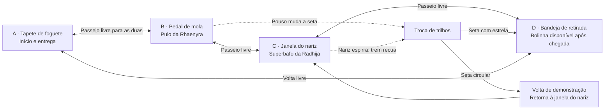

# Proposta da fase 6: Expresso do Superbafo

Data: 17 de outubro de 2026. Responsável: Codex, frente de planejamento.

O usuário pediu uma combinação mais criativa de pulo e superbafo e rejeitou
repetir o pombo. Esta revisão substitui **Operação Piquenique** por uma oficina
de brinquedos com um pequeno trem de nariz mecânico. **Cenário e puzzle aprovados
para protótipo em 17/10/2026**, após apresentação da imagem conceitual. O usuário
exigiu preservar a direção artística existente: maquete procedural, materiais,
iluminação, escala e câmera coerentes com as fases atuais e personagens intactas.
A aprovação do conceito não aprova antecipadamente a versão jogável/publicação.
Protótipo posteriormente aprovado e publicado pelo PR #15, preservado no #16.
Este documento conserva o desenho do puzzle; estado real em CONTEXTO.md e
próxima entrega em [CONTINUIDADE-FASE6.md](CONTINUIDADE-FASE6.md).

**Missão:** recuperar uma bolinha pintada como um planeta, que ficou no vagão,
e levá-la ao tapete de foguete das duas irmãs. Rhaenyra pula sobre um pedal de
mola para mudar o trilho. Radhija solta superbafo no nariz da locomotiva: ela faz
“atchim!”, engata a ré e leva a bolinha pelo caminho escolhido. Se o trilho
estiver errado, o trem dá uma volta e retorna ao início; o erro ensina a solução
sem perder o brinquedo ou exigir reinício.

O pulo **aciona o mecanismo pelo pouso**, em vez de apenas atravessar uma cerca.
O bafo **provoca a reação que movimenta o brinquedo**, em vez de conduzir um
animal até uma placa. Não há pombo, ventilador, duto ou portão nesta proposta.
São os mesmos comandos de pulo, troca de personagem, superbafo e interação.

## Cenário e mapa

Oficina acolhedora de brinquedos, em corte de maquete: chão de madeira, caixas
de lápis, planetas de papel pendurados e uma ferrovia de brinquedo em um canteiro
central cercado por uma borda contínua. O nariz de mola e os olhos pintados
deixam claro que a locomotiva é um brinquedo engraçado. Tudo pode ser procedural.

As dogs andam no mesmo plano de chão. A ferrovia é uma área separada, sem
acesso para as personagens. O trem não funciona como plataforma e não carrega
dogs. Três estações externas ficam conectadas por um passeio largo:

O desenho mostra relações, não escala. Norte é −Z; a câmera observa do sul.
O protótipo decide coordenadas e margens com os raios reais das dogs. O pedal
fica fora da ferrovia, rente ao chão, com área útil larga: a criança pode parar
no centro e pular no lugar. Nenhum salto sobre vão, equilíbrio, subida em móvel
ou pouso numa plataforma pequena é necessário.

A bolinha usa o tipo existente `ball`, com pintura nova de planeta e nome nos
textos da fase. Assim, o protótipo pode aproveitar pose de boca, ícone e entrega
existentes; não precisa criar um tipo global de item. A arte final da bolinha,
locomotiva, pedal, trilhos e oficina ainda precisa ser construída.

## Sequência jogável

### 1 Descobrir o trilho que leva à bolinha

A bolinha aparece no vagão, e uma linha de estrelas no trilho aponta para a
bandeja vazia. A seta inicial da troca de trilhos mostra uma volta circular.
O pedal tem uma mola visível e um desenho de patinhas saltando. Andar ou ficar
parada sobre ele comprime um pouco a mola, mas não passa a catraca.

Com Rhaenyra, parar no pedal e pular faz o pouso avançar uma posição: a seta
gira, um pequeno estalo confirma e a junção passa a apontar para a bandeja.
Outro pulo alterna de volta. A escolha permanece quando ela sai do pedal ou
troca de personagem; não é necessário usar “Fica” nem manter peso sobre ele.

Objetivo: “Pule no pedal com a Rhaenyra para apontar o trilho para a estrela”.
Dica ao ficar sobre ele: “A mola precisa de um pulão! Pare aqui e pule”. A seta
e o desenho do caminho distinguem as posições sem depender apenas da cor.

### 2 Fazer o trem espirrar pelo caminho escolhido

Trocar para Radhija e ir à janela do nariz. A locomotiva está parada, olhando
para a janela; o vagão está atrás dela. A criança mira o superbafo no nariz.
A nuvem realmente precisa alcançá-lo. Nariz amassa, olhos fecham e o espirro
engata a marcha à ré, levando o vagão à frente pelo trajeto selecionado.

A junção fica travada durante o percurso. Um sopro basta: não é necessário
acompanhar o trem, soprar de novo, correr até o pedal ou trocar no momento certo.
Uma tomada curta mostra nariz → vagão → destino e retorna para a personagem.

- **Seta circular:** o trem percorre um circuito curto e volta à posição inicial,
  ainda com a bolinha. Mostra “Ele deu a volta! O pedal muda o caminho”.
- **Seta da estrela:** o trem chega à estação de retirada, onde uma canaleta
  deposita a bolinha na bandeja ao alcance das dogs. O trem fica estacionado.

Objetivo com a rota correta: “Faça a locomotiva espirrar com o superbafo da Radhija”.
Latir ou apertar interação no nariz pode dar a dica, mas não substitui o bafo.
O sensor mecânico é a regra cômica desta oficina; não se trata de simulação de
pressão, propulsão física ou capacidade já existente da locomotiva.

### 3 Levar o planeta para o foguete

Qualquer irmã pode pegar a bolinha na bandeja e levá-la ao tapete de foguete.
Objetivo: “Leve a bolinha-planeta ao tapete de foguete”. A companheira acompanha
pelo passeio. Três petiscos opcionais ficam em desvios externos da oficina;
nenhum exige entrar na ferrovia ou impede a conclusão.

## Estados, ações fora de ordem e reset

Estados locais propostos: `waiting`, `sneezing`, `movingLoop`, `movingDelivery`,
`returning`, `ready`, `carrying`, `done`. A rota escolhida é `loop` ou `delivery`,
separada do estado; a partida do trem copia essa escolha para uma rota imutável
até o fim da viagem. O objetivo reflete o que falta agora, sem exigir que o
jogador siga a sequência narrativa.

| Ação | Resultado esperado |
|---|---|
| Soprar antes de usar o pedal | Volta de demonstração e retorno automático com a bolinha; nada perdido. |
| Pular no pedal mais de uma vez | Uma troca por pouso válido, somente com trem parado; não alternar a cada quadro. |
| Andar, correr, latir, interagir ou estacionar sobre o pedal | Não mudar o trilho; dica específica de pulo. |
| Pousar fora da área útil | Não acionar; área visível e margem generosa coincidem com a área aceita. |
| Trocar de dog durante o salto | O pouso real da Rhaenyra continua contando; observar ambas as controllers. |
| Pular durante o percurso ou espirro | Pedal dá retorno visual de ocupado, sem enfileirar uma mudança invisível. |
| Soprar durante o movimento | Não criar outro percurso, espirro ou entrega; nuvens continuam seu ciclo normal. |
| Trem voltar enquanto ainda há bafo no nariz | Aguardar a área ficar livre e, ao rearmar, guardar os IDs de todas as nuvens ainda existentes; nenhuma delas pode iniciar nova viagem, mesmo chegando depois. |
| Sopro lateral, por trás ou através da borda | Rejeitar definitivamente essa nuvem para este nariz; orientar para a janela frontal e pedir um novo sopro. |
| Tentar pegar a bolinha no vagão ou durante a canaleta | Interação recusada até `ready`, mesmo se a distância calculada permitir. |
| Pegar/trocar personagem depois da chegada | Bolinha fica com a portadora; ambas podem entregar pelo passeio. |
| Pular/soprar depois da retirada | Não reiniciar trem nem duplicar bolinha ou eventos de sucesso. |
| Pausar durante salto, espirro ou viagem | Simulação e temporizadores param; retomar no mesmo ponto. |
| Reiniciar em qualquer estado | Restaurar trem, rota, nariz, pedal, bolinha, nuvens, dicas e petiscos. |

`reset()` deve devolver a bolinha antes de recolocar o trem e zerar todas as
animações/temporizadores da fase. Sem `setTimeout` para concluir viagens:
avançar por `dt` no puzzle, respeitando pausa e descarte. `jumpToStage()` monta
estados coerentes para depuração, sem efeitos ou callbacks duplicados.

Registrar o nariz uma vez por instância. `scent.reset()` limpa nuvens, mas
preserva os registros; `dispose()` de EST-05 encerra os callbacks. O estado de
rearme e o conjunto de IDs bloqueados devem ser limpos no reinício e descarte.
Ao rearmar, substituir esse conjunto por um snapshot dos IDs de **todas** as
nuvens presentes em `scent.clouds`, inclusive longe do nariz. `onSmell` ignora
esses IDs: apenas uma nuvem criada depois do rearme pode iniciar nova viagem.
Podar IDs que já não existem no campo de cheiro a cada atualização; não acumular
o histórico de viagens. Área frontal vazia sozinha não prova um sopro novo.

## Limitações verificadas e implementação necessária

Referências inspecionadas na base `597c8f2` (PR #12 integrado). Esta tabela
distingue suporte já existente da lógica que o protótipo ainda precisa criar.

| Peça | Reuso real e trabalho novo |
|---|---|
| Pulo no lugar | `startJump` de `dogController.js` já mantém a velocidade atual sem entrada: parada permite pulo no lugar. `jumpT` e `landed` existem. Não há chão elevado ou plataforma móvel. |
| Pedal de impacto | **Novo componente local da fase.** `createPressurePlate` detecta peso contínuo e ignora quem está no ar; sozinho não prova um pulo. Observar o pouso real de Rhaenyra e a posição final, uma vez por salto. |
| Momento de leitura do pouso | Hoje `puzzle.update` roda depois de integrar as duas dogs e antes de `applyDogs` consumir `landed`. Usar esse contrato com teste de regressão real; não inferir aterrissagem apenas de uma animação visual ou do evento enviado posteriormente. |
| Superbafo | Mira, lançamento, nuvem, recarga e `ctx.scent.addNose({ onSmell })` já existem. Criar condição frontal, habilitação por estado e rearme com snapshot dos IDs existentes. Cada nariz só recebe uma chamada por nuvem; rejeitar o contato consome essa tentativa. |
| Trilhos e trem | **Novos props e lógica local.** Duas rotas XZ fixas no layout, movimento determinístico por `dt`, rotação visual e entrega pela canaleta. Não há trem ou mecanismo de trilhos compartilhado pronto. |
| Item e objetivos | `createCarryItem`, `createHints`, `createCollectibles`, `deliveredAt` e `buildTreats` existem. A bola da fase 2 é um construtor interno, não um export reutilizável; modelar a bolinha local sem importar o cenário todo. |
| Câmera e efeitos | O puzzle já pode solicitar tomadas por `cam`. Desenhar animação do nariz, pedal e trem; reutilizar eventos existentes apenas quando tiverem o mesmo significado, criando eventos específicos da fase se necessários. |
| Contratos e recursos | Declarar `Fase6Props`, `LevelDef<Fase6Props>` e `PuzzleContext<Fase6Props>`; fábrica explícita e testes com props reais. Montar em `root`, registrar recursos fora da árvore e seguir o descarte de EST-05. |

Fontes: [controller](../src/game/dogController.js),
[ordem do update](../src/game/game.js),
[placa de pressão](../src/game/mechanics/pressurePlate.js),
[campo de cheiro](../src/game/mechanics/scent.js),
[kit de puzzle](../src/game/puzzleKit.js) e [tipos](../src/types.d.ts).

O contrato visual novo deve expor funções pequenas, por exemplo `pedal.setPress`,
`junction.setRoute`, `train.setPose`, `nose.setSneeze`, `ball.object`,
`collectibles` e `reset`, com tipos explícitos. O puzzle é dono do estado; os
props só desenham. Manter a bolinha sob `root` enquanto viaja, atualizando sua
pose conforme o vagão, permite que `createCarryItem` capture uma origem estável.
Após a descarga, o puzzle para de mover a bolinha; ao pegar, o helper assume
sua pose na boca. Testar também parent/posição/rotação depois de reset.

### Cheiro, colisão e prevenção de atalhos

O cheiro usa XZ. A nuvem colide com paredes como um círculo pequeno, mas o
teste de `addNose` usa distância e **não faz oclusão**. Altura do nariz, vidro
decorativo ou uma parede entre nuvem e alvo não bastam para rejeitar um sopro.
Além disso, `scent.update` marca `c.smelled.add(n.id)` **antes** de chamar
`onSmell`. A escolha desta proposta é manter essa API: um primeiro contato
inválido encerra a tentativa daquela nuvem, ainda que ela depois entre pela
frente. Mostrar “Mire pela janela do nariz e solte outro superbafo”. Não esperar
uma segunda chamada nem remover a marca do campo de cheiro para tentar de novo.

- Colocar o nariz numa janela frontal aberta, acessível por um recuo amplo.
  Usar contato + centro da nuvem dentro do setor frontal definido no layout
  para aceitar `onSmell`; não aceitar apenas a distância do nariz. Os limites
  devem coincidir com a geometria visível, sem “pixel certo” oculto.
- Afastar o nariz das faces laterais e traseiras considerando `nose.r +
  cloud.r * 0.7` (raio calmo atual até 1,05 m). Testar todo o contorno, nuvem
  parada espalhando e máxima aproximação das dogs; uma altura visual não prova
  isolamento. Se necessário, aumentar o recuo em vez de mudar o núcleo.
- Trava lógica de retirada: somente `ready` habilita a interação, no ponto
  externo da bandeja. A borda contínua da ferrovia não é `jumpable`; conferir
  cantos, cabeças atravessando a margem de alcance e salto sobre decoração.
- Dogs e trem ocupam regiões separadas por colisores estáticos. Nenhum colisor
  móvel empurra ou prende as personagens; elas não podem interceptar o trem.
  A canaleta entrega a bola em um ponto externo livre de colisão.
- Navegação da companheira usa somente o passeio externo e pontos de espera
  fora do pedal/linha de mira. Todas as estações e o objetivo são alcançáveis
  pelas duas. A IA não precisa pular; “Fica” é opcional para organizar a cena.

### Câmera e legibilidade

A composição deve mostrar pedal, seta e linha de estrelas na mesma região.
Na janela, nariz e bolinha no vagão aparecem juntos. Evitar móveis altos entre
câmera e estação; decoração pendurada não cobre objetivos ou controles. Tomadas
curtas mostram mudanças sem exigir que a criança aja durante uma animação.

Dicas progressivas: primeiro desenho/movimento, depois uma frase sobre a
habilidade, por fim o comando com o markup existente para teclado/controle.
Se a rota circular for usada, destacar a seta, sem tratar tentativa como derrota.
Sem limite de tempo, sincronização entre dogs ou penalidade por experimentar.

## Critérios e evidências do protótipo entregue

PR #15 aprovado no head corrigido `05e2287`, publicado por squash `b954b24`.
CI `39082917531`: 207 testes/tipos/build; E2E `39082921941`: 24 verificações
Expresso, infraestrutura/smoke/recuperação e recursos das seis fases aprovados.
Detalhes e limitações no CONTEXTO; o catálogo normal ainda tem cinco fases.

- [x] Usuário escolheu oficina, trem que espirra e bolinha-planeta, com arte na
  mesma direção do jogo; aprovou a versão jogável como blocagem.
- [x] Pouso real aciona pedal uma vez; andar, ficar, latir/interagir não o substituem.
  Troca de personagem no ar preserva o pouso único.
- [x] Superbafo real frontal aciona o trem; aproximação/latido/interação e contato
  lateral não substituem o sopro. Rota circular recuperável e entrega funcionam.
- [x] Rota congelada em movimento, rearme bloqueia nuvens antigas (inclusive
  distantes), poda/reset dos IDs, retirada só em ready e regressão da dica falsa.
- [x] Pausa, reinício e troca de fase em todos os estados, incluindo item na boca;
  contratos reais, factories explícitas e navegação/colisão do passeio cobertos.
- [x] Suíte expresso registrada no runner e workflow/todas; smoke em subcaminho e
  recursos incluem a fase DEV. Capturas revisadas e prévia aprovada pelo usuário.
- [ ] Acabamento visual, curvas/articulação do trem e som exclusivo do espirro.
- [ ] Partida de revisão caminhando entre estações durante o acabamento; o E2E
  atual posiciona personagens para preparar trechos das interações reais.
- [ ] Promoção ao catálogo, progressão 5→6, URL por ID, saves/hasNext, pressupostos
  dos testes e protocolo temporal de seis fases. Isso não fazia parte da publicação DEV.

## Sequência de entrega e coordenação

1. **Escolha do desenho e protótipo:** concluídos; proposta do #9 incorporada ao
   #15, publicado. Não pedir novamente escolha de cenário nem reimplementar a blocagem.
2. **Acabamento mantendo DEV:** próxima entrega, com movimento, cenário, câmera,
   dicas e som coerentes; revisar prévia própria e obter aprovação dessa versão.
3. **Campanha:** depois do acabamento validado, promover catálogo/progresso,
   revisar testes/medição e apresentar outra prévia para aprovação.

A estabilização EST-00 a EST-09 foi encerrada com o PR #16. Não há impedimento
arquitetural pendente para iniciar o acabamento. O checklist e a divisão de
arquivos por agente estão em [CONTINUIDADE-FASE6.md](CONTINUIDADE-FASE6.md).
Manter worktrees exclusivos, coordenar arquivos compartilhados e integrar uma
frente por vez. A prévia por PR isola o progresso; DEV_LEVELS sozinho não cria
uma chave de save separada. Aprovações antigas não cobrem novas versões.

PR #9 encerrado como substituído pelo #15; história da proposta preservada no Git.
A alternativa antiga com quintal, ursinho e pombo foi rejeitada pelo usuário.
